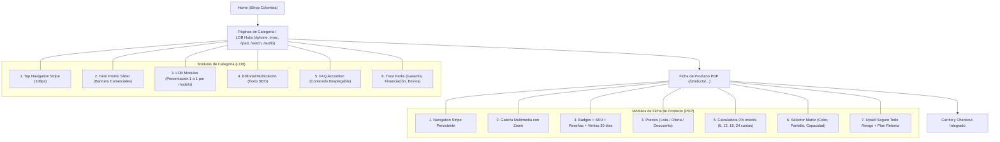

# Benchmark de Arquitectura y Módulos de iShop Colombia

> **Auditoría Técnica y Visual en Vivo** realizada mediante Chrome DevTools MCP sobre `https://co.tiendasishop.com`.
> **Objetivo:** Definir la especificación estándar para los módulos, navegación, páginas de categoría (LOB) y ficha de producto (PDP) de **iZone Tech**.

---

## 1. Mapa Global de Arquitectura del Sitio

---

## 2. Design Tokens y Sistema Visual de iShop

| Token / Elemento | Valor iShop | Implementación en iZone Tech |
| :--- | :--- | :--- |
| **Naranja Comercial (CTA / Ofertas)** | `#F68025` | `#FF6B1A` / `#F68025` |
| **Naranja Oscuro (Tag "NUEVO")** | `#BF4800` | `#BF4800` |
| **Azul Apple (Acciones / Links)** | `#0071E3` | `#0071E3` |
| **Gris Fondo Banner** | `#2D3035` / Gradiente oscuro | `from-[#4A4E54] to-[#1E2024]` |
| **Línea Divisoria** | `#D2D2D2` / `inset 0 -0.5px #d2d2d2` | `shadow-[inset_0px_-0.5px_0px_#d2d2d2]` |
| **Tipografía Principal** | `SF Pro Text`, -apple-system, sans-serif | `Inter`, `SF Pro Display`, sans-serif |
| **Radio de Bordes Botones** | `42px` (Píldora completa) | `rounded-full` |
| **Dimensiones Miniatura Strip** | `84px x 84px` cuadrado con recorte PNG | `w-[84px] h-[84px] object-contain` |
| **Altura Strip Superior** | `108px` (padding vertical 12px) | `h-[108px] max-h-[108px]` |

---

## 3. Desglose Detallado de Módulos (Benchmark LOB)

### Módulo 1: Navigation Stripe (`#shopify-section-navigation_stripe`)
* **Propósito:** Permite al usuario saltar directamente entre las diferentes generaciones y familias sin recargar la página.
* **Comportamiento:**
  - Sticky debajo de la barra principal.
  - Desplazamiento horizontal táctil (swipe/drag) con flechas laterales paginadas.
  - La flecha derecha tiene un divisor vertical sutil (`border-l`) y fondo blanco opaco de 36px.
* **Estructura de Tarjeta (`.apl_lob_list_item`):**
  - **Imagen (84x84):** Recorte limpio del dispositivo en ángulo oficial.
  - **Etiqueta Superior:** `NUEVO` (#BF4800) o `OFERTA` · `UNIDADES LIMITADAS` (#F68025) en 8px mayúsculas negrita.
  - **Título del Modelo:** 11.5px - 12px semibold, truncado si es necesario.
  - **Precio Inicial:** `Desde $X.XXX.XXX` en 9.5px regular, color neutro tenue.

### Módulo 2: Hero Slider Comercial (`.slider_clickable`)
* **Propósito:** Campaña promocional de alto impacto enfocada en financiación y descuentos.
* **Elementos Clave extraídos:**
  1. Slide iPhone 17 Pro: Descuento hasta de `$700.000*`, Estrena en **24 cuotas** sin interés.
  2. Slide iPhone 17: Campaña de color y chip A19.
  3. Slide Guía: *"¿Qué iPhone elegir?"*.
  4. Botón Naranja de Acción: `[ COMPRA AHORA ]` redondeado en píldora con microinteracción hover.
  5. Controles de Diapositiva: Cápsula blanca flotante con puntos (`dots`) en la parte inferior central.

### Módulo 3: LOB Showcase Rows (`.lob-module`)
* **Propósito:** Ficha de presentación 1 a 1 de cada producto en la categoría antes de pasar al catálogo general.
* **Anatomía de cada fila:**
  - **Título:** `iPhone 17 Pro`, `iPhone 17`, `iPhone 17e`, `iPhone Air`.
  - **Slogan Comercial:** *"Totalmente Profesional"*, *"Espectacolor"*, *"El poder de un pro"*.
  - **Precio:** `Desde $X.XXX.XXX*`.
  - **Prueba Social (Social Proof):**
    - Puntuación en estrellas: `4.9 ★★★★★ (202)`
    - Indicador de velocidad de venta: `1 K+ vendidos en 30 días (i)`
  - **Botones de Conversión:**
    - Botón primario: `[ Comprar ]` contorno azul o relleno.
    - Botón secundario: `[ Ver modelo ]`.
  - **Arte de Producto:** Render 3D en alta resolución a la derecha o alternado.

### Módulo 4: Contenido Editorial y SEO (`.multicolumn_sec`)
* **Propósito:** Posicionamiento en buscadores y educación del comprador.
* **Contenido extraído:**
  - Explicación de las familias A19 y A19 Pro.
  - Tabla de colores disponibles (Naranja Cósmico, Azul Oscuro, Plata, etc.).
  - Ventajas de comprar en canal oficial autorizado.

### Módulo 5: Preguntas Frecuentes Desplegables (FAQ Accordion)
* **Propósito:** Eliminar fricciones de compra (objeciones sobre IA, compatibilidad, capacidades, financiación).
* **Preguntas Oficiales:**
  1. *¿Cuáles son las características del iPhone 17e?*
  2. *¿Los iPhone 17 incluyen IA? (Apple Intelligence)*
  3. *¿Qué modelos iPhone 17 se lanzaron?*
  4. *¿Qué capacidad tiene el iPhone 17?*
  5. *¿Cuáles son las diferencias entre el iPhone 17 y el iPhone 17 Pro?*

---

## 4. Desglose de Ficha de Producto (Benchmark PDP)

La página individual de producto de iShop implementa una arquitectura pensada para maximizar la tasa de conversión en Colombia mediante:

1. **Persistencia del Navigation Stripe:** El carrusel de modelos se mantiene visible en la parte superior para permitir comparaciones rápidas.
2. **Badge de Urgencia y Disponibilidad:**
   - `OFERTA`
   - `UNIDADES LIMITADAS`
   - `Este producto tiene Envío Gratis y aplica envío Express en ciudades principales.`
3. **Módulo Financiero Bancario:**
   - Selector interactivo de cuotas: **6 | 12 | 18 | 24 meses** con cálculo dinámico del valor mensual (ej. `$239.542/mes`).
   - Bancos integrados: **Bancolombia, Banco de Bogotá, Davivienda (Plan 0 es 3) y Addi**.
4. **Matriz de Variantes:**
   - Color con visualización del nombre exacto (ej. *Azul intenso*, *Naranja cósmico*).
   - Selector de tamaño de pantalla/modelo (ej. *iPhone 17 Pro* vs *iPhone 17 Pro Max*).
   - Selector de capacidad con actualización de stock en tiempo real (*256 GB, 512 GB, 1 TB, 2 TB*).
5. **Upsells de Alta Confianza:**
   - Cobertura Todo Riesgo por 12 meses con aseguradora aliada (Seguros Mundial).
   - Módulo de Plan Retoma (Trade-in con descuento en parte de pago).

---

## 5. Implementación Aplicada en iZone Tech

Todas estas especificaciones han sido trasladadas e implementadas con código nativo en `izone-ecommerce`:

### A. Módulos de Categoría (LOB Hubs):
- [`CategoryModelCarousel.tsx`](file:///Users/kinma/Documents/Web%20Dev/izone-ecommerce/apps/web/src/components/shop/CategoryModelCarousel.tsx): Replicó exactamente los 108px de altura, miniatura de 84x84, tipografías, badges y flechas laterales.
- [`category-models.ts`](file:///Users/kinma/Documents/Web%20Dev/izone-ecommerce/apps/web/src/lib/category-models.ts): Contiene los catálogos y enlaces a imágenes oficiales para iPhone, Mac, iPad, Apple Watch y Audio.
- [`CategoryHub.tsx`](file:///Users/kinma/Documents/Web%20Dev/izone-ecommerce/apps/web/src/components/shop/CategoryHub.tsx): Incluye el slider de banners con Autoplay, paginador por puntos e indicadores de prueba social (`X vendidos en 30 días`, calificación por estrellas).

### B. Módulos de Ficha de Producto (PDP):
- [`FinancingCalculator.tsx`](file:///Users/kinma/Documents/Web%20Dev/izone-ecommerce/apps/web/src/components/product/FinancingCalculator.tsx): Calculadora interactiva 0% interés multibanco (6, 12, 18, 24 cuotas con Banco de Bogotá, Bancolombia, Davivienda Plan 0 es 3 y banner Addi).
- [`StickyBuyBar.tsx`](file:///Users/kinma/Documents/Web%20Dev/izone-ecommerce/apps/web/src/components/product/StickyBuyBar.tsx): Barra flotante inferior anclada que aparece tras scroll superior (>450px) mostrando miniatura, variante, precio, cuota mensual y botón de compra rápida.
- [`VariantSelector.tsx`](file:///Users/kinma/Documents/Web%20Dev/izone-ecommerce/apps/web/src/components/product/VariantSelector.tsx): Selector desacoplado de variantes (swatches circulares con nombre activo, pills de almacenamiento, checkbox de Seguro Todo Riesgo por 12 meses, cotización de Plan Retoma y métodos de entrega).
- [`RecommendedAccessories.tsx`](file:///Users/kinma/Documents/Web%20Dev/izone-ecommerce/apps/web/src/components/product/RecommendedAccessories.tsx): Módulo de venta cruzada ("Los más elegidos con [Producto]") con fundas MagSafe, cargador USB-C de 20W, protector cerámico GlassGuard y cargador MagSafe.
- [`ProductSpecsAccordion.tsx`](file:///Users/kinma/Documents/Web%20Dev/izone-ecommerce/apps/web/src/components/product/ProductSpecsAccordion.tsx): Acordeón colapsable con pestañas de características destacadas (Apple Intelligence), especificaciones técnicas completas, contenido de la caja y garantía oficial de 1 año.
- [`apps/web/src/app/product/[slug]/page.tsx`](file:///Users/kinma/Documents/Web%20Dev/izone-ecommerce/apps/web/src/app/product/%5Bslug%5D/page.tsx): Ensambla toda la ficha de producto con el carrusel de modelos superior persistente, badges de oferta, identificadores SKU/Barcode, prueba social y layout responsive.
